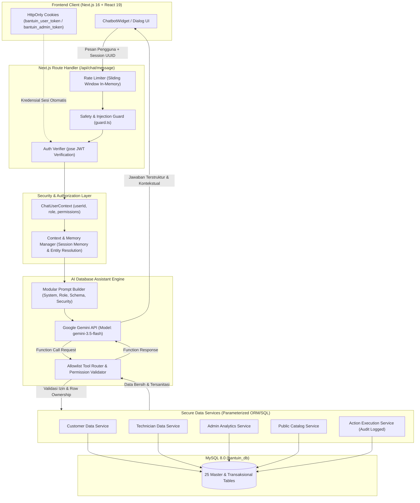

# CHATBOT+ ARCHITECTURE: ENTERPRISE AI DATABASE ASSISTANT

Aplikasi: **BANTUIN (Layanan Perbaikan Elektronik Rumah Tangga)**  
Peran Arsitektur: **Senior Software Architect, Senior AI Engineer, Database Engineer, Cybersecurity Engineer**

---

## 1. Ikhtisar Arsitektur

Chatbot+ pada aplikasi BANTUIN telah berevolusi dari sekadar chatbot diagnosis berbasis aturan menjadi **Enterprise AI Database Assistant** yang:
1. Memahami secara mendalam struktur dan relasi 25 tabel basis data MySQL 8.0 BANTUIN melalui **Schema Registry**.
2. Menggunakan **Server-Side Authorization & Row-Level Security (RLS)** untuk memastikan setiap pengguna hanya dapat membaca atau menganalisis data sesuai hak akses peran (*Role-Based Access Control*).
3. Menggunakan **Gemini API** (`gemini-3.5-flash` / `@google/generative-ai`) dengan arsitektur **Allowlist Tool / Function Calling & Retrieval-Augmented Data Service**.
4. **Zero Direct SQL Execution**: AI model tidak memiliki koneksi langsung ke MySQL dan tidak dapat mengeksekusi raw query SQL yang rentan injeksi.
5. Mendukung **Action Intelligence** (pembaruan status perbaikan teknisi dan ringkasan audit log admin) dengan verifikasi dua langkah (*2-step verification*) dan pencatatan audit.

---

## 2. Alur Kerja Pemrosesan Pesan (End-to-End Workflow)

1. **Pengiriman Pesan**: Pengguna mengirimkan pertanyaan melalui antarmuka `ChatbotWidget`.
2. **Rate Limiting**: Backend memverifikasi batas frekuensi (maksimal 30 pesan/menit per alamat IP).
3. **Safety & Injection Guard**: Pesan diperiksa terhadap:
   - Pola ancaman keselamatan kerja (*Safety Hazard*: bau hangus, percikan api, kebocoran gas, sengatan listrik).
   - Pola injeksi prompt (*Jailbreak / System Prompt Leakage*).
   - Pertanyaan di luar lingkup aplikasi BANTUIN.
4. **Server-Side Authentication**: Backend memvalidasi cookie `bantuin_admin_token` atau `bantuin_user_token` menggunakan kunci rahasia JWT (`jose`). Backend mengekstrak `userId`, `role`, dan data status akun terverifikasi. Nilai peran dari klien **tidak pernah dipercaya**.
5. **Context & Entity Resolution**: Sistem mengambil riwayat percakapan dari `ai_chat_messages` dan mengenali entitas referensial (misalnya *"pesanan tadi"*, *"teknisi saya"*, *"tagihan itu"*).
6. **Dynamic Prompt Assembly**: Prompt dibangun secara modular sesuai peran pengguna yang terverifikasi, menyertakan metadata tabel yang relevan dan deklarasi allowlist function tools.
7. **Gemini Intent & Tool Planning**: Gemini menganalisis kebutuhan data dan memicu pemanggilan tool terdaftar (*Function Calling*).
8. **Server-Side Tool Authorization**: Backend memvalidasi apakah peran pengguna diizinkan memanggil fungsi tersebut dan menyuntikkan `userId` sesi server ke dalam parameterized SQL query (mencegah IDOR).
9. **Data Retrieval & Masking**: Database MySQL mengembalikan baris data yang difilter. Nilai sensitif (hash password, token) dihilangkan sebelum diserahkan ke LLM.
10. **LLM Contextual Synthesis**: Gemini menerima data faktual dan menyusun jawaban profesional berbahasa Indonesia dengan menyertakan tabel, daftar rincian, atau *DiagnosisCard*.
11. **Penyimpanan Riwayat Percakapan**: Respons dan token metadata dicatat ke tabel `ai_chat_messages`.
12. **Pengiriman ke Pengguna**: Klien menerima respons terstruktur beserta rekomendasi pertanyaan cepat (*suggested prompts*) yang dinamis.

---

## 3. Komponen Utama Sistem

### 3.1 Schema Registry (`schema-registry.ts`)
Menyediakan katalog terstruktur berisi metadata 25 tabel basis data:
- Nama tabel, tujuan bisnis, primary key, dan foreign key.
- Daftar kolom dan tipe data.
- Kolom penanda kepemilikan baris (*ownership keys*: `customer_id`, `user_id`, `technician_id`).
- Daftar kolom sensitif yang wajib di-filter.

### 3.2 Role-Based Data Services (`data-service.ts`)
Koleksi fungsi query SQL terparameterisasi dengan isolasi ketat:
- **Customer Services**: Membaca profil, pesanan aktif, linimasa perbaikan, rincian biaya estimasi, tagihan invoice, dan ulasan milik pengguna yang login.
- **Technician Services**: Membaca tugas yang ditugaskan, batas waktu, keluhan pelanggan, riwayat diagnosa teknis, serta performa penyelesaian pekerjaan.
- **Admin Analytics Services**: Menghitung metrik operasional, sebaran status pesanan, utilisasi teknisi, perbaikan tertunda, analitik pendapatan, dan status layanan sistem.
- **Public Services**: Mengambil katalog kategori aktif, tarif dasar layanan, dan SOP kebijakan garansi 30 hari BANTUIN.

### 3.3 Action Intelligence (`action-service.ts`)
Mendukung interaksi operasional yang aman:
- **Aksi Teknisi**: Memperbarui status tugas (`on_the_way`, `start_diagnosis`, `start_repair`) dan mencatat laporan diagnosa.
- **Aksi Admin**: Menghasilkan ringkasan laporan operasional formal ke tabel `admin_audit_logs`.
- **Protokol Konfirmasi**: Tindakan berisiko tinggi mewajibkan konfirmasi dua langkah sebelum eksekusi mutasi pada basis data.

### 3.4 Context & Entity Resolver (`context-manager.ts`)
Mengelola memori percakapan berbasis sesi:
- Menyimpan identitas aktif perbaikan (`activeOrderCode`, `activeRepairId`, `activeTechnicianId`) dalam konteks sesi.
- Mengubah pertanyaan bertingkat (contoh: *"Berapa estimasi biayanya?"* setelah *"Bagaimana status AC saya?"*) menjadi query spesifik terhadap pesanan aktif yang dibahas.

### 3.5 Dynamic Suggested Prompts (`suggested-prompts.ts`)
Menyajikan tombol pertanyaan cepat (*quick prompt chips*) pada antarmuka pengguna yang berubah secara dinamis berdasarkan peran pengguna, halaman aktif yang sedang dibuka, serta data riil pengguna di database.

