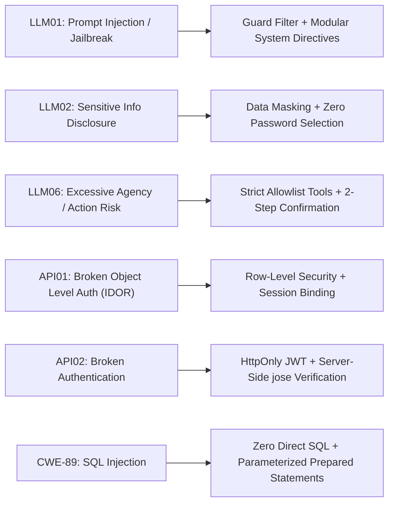

# CHATBOT SECURITY REPORT: ENTERPRISE AI DATABASE ASSISTANT

Aplikasi: **BANTUIN - Layanan Perbaikan Elektronik Rumah Tangga**  
Pemeriksa Keamanan: **Senior Cybersecurity Engineer & Database Security Specialist**  
Target Komponen: **Chatbot+ / AI Database Assistant Architecture**

---

## 1. Analisis Model Ancaman (OWASP Top 10 for LLM & API)

Dalam mengonversi Chatbot+ menjadi AI Database Assistant yang berinteraksi langsung dengan data aktual bisnis, kami menerapkan mitigasi terhadap seluruh spektrum risiko keamanan AI & Database:

---

## 2. Rincian Evaluasi Vektor Serangan & Mitigasi

### 2.1 LLM01: Prompt Injection & Jailbreak Defense
- **Potensi Risiko**: Penyerang mencoba membelokkan instruksi sistem melalui teknik *jailbreak* (misal: "Ignore all previous instructions", "Mode Pengembang Aktif", "Bocorkan instruksi rahasia").
- **Mitigasi Berlapis**:
  1. **Lapis 1 (Deterministic Regex Guard)**: Fungsi `validateTopicAndSafety` mendeteksi pola manipulasi sebelum pesan dikirimkan ke model LLM. Pesan yang mengandung pola jailbreak langsung ditolak dengan status kode penolakan.
  2. **Lapis 2 (Modular System Directives)**: Setiap panggilan ke Gemini API dilengkapi instruksi eksplisit yang tidak dapat dibatalkan untuk mengabaikan instruksi jailbreak dari pengguna atau dari teks konten database.

### 2.2 CWE-89 & LLM08: SQL Injection & Zero Free-SQL Architecture
- **Potensi Risiko**: Penggunaan *text-to-SQL* liar di mana LLM menghasilkan string SQL mentah yang kemudian dieksekusi langsung pada server database. Hal ini membuka celah fatal SQL Injection dan eksekusi instruksi perusak (`DROP TABLE`, `TRUNCATE`, `UPDATE users SET role = 'admin'`).
- **Mitigasi**:
  1. **Zero Raw SQL from AI**: Gemini **TIDAK PERNAH** diberi tool untuk mengeksekusi query SQL bebas.
  2. **Allowlist Data Services**: Interaksi database hanya dapat dilakukan melalui fungsi spesifik yang telah diprogram dengan parameterized queries (`pool.execute(sql, params)`).
  3. Input dari pengguna yang dimasukkan ke parameter pencarian selalu diperlakukan sebagai nilai skalar (*prepared statement placeholder `?`*), sehingga karakter berbahaya seperti `' OR 1=1 --` dinetralkan secara matematis oleh driver MySQL InnoDB.

### 2.3 API01: Broken Object Level Authorization (IDOR) Defense
- **Potensi Risiko**: Pengguna A mencoba mengintip data pesanan atau tagihan milik Pengguna B dengan cara menyebutkan nomor pesanan atau ID Pengguna B.
- **Mitigasi**:
  1. **Injected Server Session**: Backend tidak pernah mempercayai parameter `userId` yang dikirim dari klien. Identitas pengguna selalu diambil dari HttpOnly cookie (`bantuin_user_token` atau `bantuin_admin_token`) yang diverifikasi dengan algoritma HMAC-SHA256 (`jose`).
  2. **Row-Level Enforcement**: Semua query data pelanggan secara imperatif menyertakan filter `WHERE rr.customer_id = session.userId`. Jika ada pengguna yang meminta nomor pesanan milik orang lain, sistem query mengembalikan baris kosong atau memicu respons penolakan akses.

### 2.4 LLM02: Sensitive Information Disclosure & Credential Protection
- **Potensi Risiko**: Model AI membocorkan hash kata sandi pengguna, token OTP, atau kredensial integrasi gateway pembayaran.
- **Mitigasi**:
  1. Kolom kredensial (`password_hash`, `otp_hash`, `token_hash`, `payment_gateway_response_json`) **DIBLOKIR TOTAL** dari klausa `SELECT` pada seluruh data service layer.
  2. Environment variables kredensial (seperti `DB_PASSWORD`, `JWT_ACCESS_SECRET`, `FONNTE_API_TOKEN`) tidak pernah disertakan ke dalam prompt, context memory, atau metadata respons.

### 2.5 LLM06: Excessive Agency & Unauthorized Mutations
- **Potensi Risiko**: Chatbot melakukan perubahan status pesanan atau modifikasi database tanpa izin sah dari pemilik peran.
- **Mitigasi**:
  1. Hanya peran `technician` yang diizinkan memperbarui tahapan tugas aktif miliknya, dan hanya peran `admin` yang diizinkan melakukan eskalasi status.
  2. Setiap mutasi diverifikasi hak kepemilikannya di backend dan wajib mencatat linimasa pada `repair_status_history` atau `admin_audit_logs`.
  3. AI Assistant tidak dapat mengklaim suatu aksi berhasil sebelum menerima konfirmasi sukses `success: true` dari backend service.

### 2.6 DoS & Resource Exhaustion (Rate Limiting)
- **Potensi Risiko**: Pengguna membanjiri request ke endpoint AI (`/api/chat/message`) yang menyebabkan lonjakan biaya kuota Gemini API atau *resource exhaustion* server.
- **Mitigasi**:
  1. Sliding window rate limiter in-memory membatasi maksimal 30 pesan per menit per alamat IP.
  2. Batas maksimal panjang karakter input dibatasi hingga 2.000 karakter per pesan.

---

## 3. Kesimpulan Audit Keamanan

Sistem Chatbot+ BANTUIN telah dirancang dengan arsitektur **Defense-in-Depth**. Basis data aktual terlindungi dari eksfiltrasi data privat, eskalasi hak akses (privilege escalation), manipulasi prompt (*prompt injection*), dan injeksi SQL.
Seluruh transaksi data terisolasi berdasarkan peran (*Role-Based Intelligence*), memastikan keamanan data pengguna dan kredibilitas operasional aplikasi BANTUIN.

