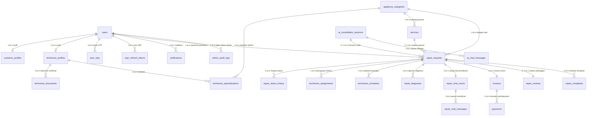

# DATABASE SCHEMA MAPPING - BANTUIN AI DATABASE ASSISTANT

Dokumen ini merupakan sumber kebenaran (*single source of truth*) pemetaan metadata seluruh 25 tabel basis data MySQL 8.0 pada aplikasi **BANTUIN**. Metadata ini digunakan oleh sistem AI Database Assistant untuk memahami relasi antarentitas, hak akses data berbasis peran (*Role-Based Access Control*), dan batasan privasi data sensitif tanpa mengekspos kredensial atau memberikan akses SQL langsung ke LLM.

---

## 1. Ringkasan Topologi Basis Data

- **DBMS**: MySQL 8.0+ (InnoDB)
- **Database**: `bantuin_db`
- **Karakter Set & Collation**: `utf8mb4` / `utf8mb4_unicode_ci`
- **Total Tabel Master/Transaksional**: 25 Tabel
- **Zona Waktu**: UTC+07:00 (WIB)

---

## 2. Klasifikasi Akses & Sensitivitas Data

| Klasifikasi | Definisi | Penanganan pada AI Chatbot |
| :--- | :--- | :--- |
| **PUBLIC** | Informasi umum (katalog, biaya dasar, panduan, FAQ) | Dapat dibaca oleh Guest, Customer, Teknisi, Admin |
| **RESTRICTED-CUSTOMER** | Data transaksi, profil, dan tagihan milik customer yang sedang login | Row-level filtering berdasarkan `user_id`/`customer_id` yang terautentikasi |
| **RESTRICTED-TECHNICIAN**| Tugas aktif, jadwal, diagnosa teknisi bersangkutan | Row-level filtering berdasarkan `technician_id` penugasan aktif |
| **RESTRICTED-ADMIN** | Statistik agregat, seluruh order, manajemen pengguna, audit log | Hanya dapat dibaca oleh role `admin` dengan token terverifikasi |
| **STRICTLY CONFIDENTIAL (BLOCKED)** | Hash password, OTP hash, token refresh, secret keys | **DILARANG KERAS** dibaca atau dikirimkan ke model AI dalam kondisi apapun |

---

## 3. Metadata Rinci 25 Tabel Basis Data BANTUIN

### GRUP 1: IDENTITAS, AUTENTIKASI & KEAMANAN AKUN

#### 1. `users`
- **Fungsi**: Master akun kredensial dan hak akses utama seluruh pengguna (Admin, Customer, Teknisi).
- **Primary Key**: `id` (BIGINT UNSIGNED)
- **Kolom**:
  - `id`: BIGINT UNSIGNED AUTO_INCREMENT (PK)
  - `uuid`: CHAR(36) (UNIQUE, Public identifier)
  - `email`: VARCHAR(191) (UNIQUE)
  - `phone_number`: VARCHAR(20) (UNIQUE, Format E.164)
  - `password_hash`: VARCHAR(255) ⚠️ **SENSITIF: BLOCKED DARI AI**
  - `role`: ENUM('admin', 'customer', 'technician')
  - `status`: ENUM('active', 'inactive', 'suspended', 'pending_verification')
  - `is_verified`: BOOLEAN
  - `deleted_at`: DATETIME NULL (Soft delete)
  - `created_at`: DATETIME
  - `updated_at`: DATETIME
- **Relasi**:
  - Dihubungkan ke `customer_profiles`, `technician_profiles`, `repair_requests`, `technician_assignments`, dll.
- **Batasan Akses**:
  - Customer: hanya dapat membaca email, phone, status verifikasi akun miliknya sendiri.
  - Teknisi: hanya dapat membaca profil akun miliknya sendiri.
  - Admin: dapat membaca daftar pengguna dan agregasi jumlah pengguna (kecuali `password_hash`).

#### 2. `user_otps`
- **Fungsi**: Penyimpanan token verifikasi OTP via WhatsApp Fonnte untuk registrasi, login, dan reset password.
- **Primary Key**: `id` (BIGINT UNSIGNED)
- **Kolom**:
  - `id`: BIGINT UNSIGNED AUTO_INCREMENT (PK)
  - `user_id`: BIGINT UNSIGNED (FK -> users.id)
  - `target_phone`: VARCHAR(20)
  - `otp_hash`: CHAR(64) ⚠️ **SENSITIF: BLOCKED DARI AI**
  - `purpose`: ENUM('registration', 'password_reset', 'login', 'phone_verification')
  - `attempts`: TINYINT UNSIGNED
  - `delivery_status`: ENUM('pending', 'sent', 'failed')
  - `fonnte_message_id`: VARCHAR(100)
  - `delivery_error`: VARCHAR(255)
  - `expires_at`: DATETIME
  - `consumed_at`: DATETIME NULL
  - `created_at`: DATETIME
- **Batasan Akses**:
  - Admin hanya dapat membaca status pengiriman OTP agregat (`delivery_status`), tidak pernah melihat isi atau hash OTP.

#### 3. `user_refresh_tokens`
- **Fungsi**: Rotasi sesi autentikasi JWT refresh token.
- **Primary Key**: `id` (BIGINT UNSIGNED)
- **Kolom**:
  - `id`: BIGINT UNSIGNED AUTO_INCREMENT (PK)
  - `user_id`: BIGINT UNSIGNED (FK -> users.id)
  - `token_hash`: CHAR(64) ⚠️ **SENSITIF: BLOCKED DARI AI**
  - `device_info`: VARCHAR(255)
  - `ip_address`: VARCHAR(45)
  - `expires_at`: DATETIME
  - `revoked_at`: DATETIME NULL
  - `created_at`: DATETIME
- **Batasan Akses**:
  - **ISOLASI TOTAL**: Tidak dapat diakses oleh AI Chatbot.

---

### GRUP 2: PROFIL, DOKUMEN & KATALOG LAYANAN

#### 4. `customer_profiles`
- **Fungsi**: Informasi profil personal pelanggan BANTUIN.
- **Primary Key**: `id` (BIGINT UNSIGNED)
- **Kolom**:
  - `id`: BIGINT UNSIGNED AUTO_INCREMENT (PK)
  - `user_id`: BIGINT UNSIGNED (FK -> users.id, UNIQUE)
  - `full_name`: VARCHAR(150)
  - `avatar_url`: VARCHAR(255) NULL
  - `default_address`: TEXT NULL
  - `city`: VARCHAR(100) NULL
  - `postal_code`: VARCHAR(10) NULL
  - `latitude`: DECIMAL(10, 8) NULL
  - `longitude`: DECIMAL(11, 8) NULL
  - `created_at`: DATETIME
  - `updated_at`: DATETIME
- **Batasan Akses**:
  - Customer: hanya dapat membaca profil miliknya (`user_id = auth.userId`).
  - Teknisi: membaca nama dan alamat hanya untuk pesanan aktif yang ditugaskan kepadanya.
  - Admin: membaca profil customer untuk verifikasi layanan/pengaduan.

#### 5. `technician_profiles`
- **Fungsi**: Profil teknisi mitra terverifikasi, rating, status kesiapan kerja, dan lokasi.
- **Primary Key**: `id` (BIGINT UNSIGNED)
- **Kolom**:
  - `id`: BIGINT UNSIGNED AUTO_INCREMENT (PK)
  - `user_id`: BIGINT UNSIGNED (FK -> users.id, UNIQUE)
  - `full_name`: VARCHAR(150)
  - `avatar_url`: VARCHAR(255) NULL
  - `bio`: TEXT NULL
  - `years_of_experience`: TINYINT UNSIGNED
  - `rating_avg`: DECIMAL(3, 2)
  - `rating_count`: INT UNSIGNED
  - `is_available`: BOOLEAN
  - `verified_status`: ENUM('pending', 'verified', 'rejected', 'suspended')
  - `rejection_reason`: TEXT NULL
  - `verified_by_admin_id`: BIGINT UNSIGNED (FK -> users.id)
  - `verified_at`: DATETIME NULL
  - `current_latitude`: DECIMAL(10, 8) NULL
  - `current_longitude`: DECIMAL(11, 8) NULL
  - `created_at`: DATETIME
  - `updated_at`: DATETIME
- **Batasan Akses**:
  - Publik & Customer: membaca nama teknisi, rating_avg, rating_count, dan ketersediaan publik.
  - Teknisi: membaca profil dan performa miliknya.
  - Admin: membaca seluruh teknisi beserta status verifikasi dokumen.

#### 6. `technician_documents`
- **Fungsi**: Dokumen sertifikat kompetensi (BNSP/BLK), lisensi, dan portofolio teknisi.
- **Primary Key**: `id` (BIGINT UNSIGNED)
- **Kolom**:
  - `id`: BIGINT UNSIGNED AUTO_INCREMENT (PK)
  - `technician_profile_id`: BIGINT UNSIGNED (FK -> technician_profiles.id)
  - `document_type`: ENUM('competency_certificate', 'training_certificate', 'portfolio', 'business_license', 'other')
  - `document_title`: VARCHAR(150)
  - `file_name`: VARCHAR(255)
  - `file_path`: VARCHAR(255)
  - `file_size_bytes`: INT UNSIGNED
  - `file_mime_type`: VARCHAR(50)
  - `issuing_organization`: VARCHAR(150)
  - `document_number`: VARCHAR(100)
  - `issue_date`: DATE
  - `expiry_date`: DATE
  - `verification_status`: ENUM('pending', 'approved', 'rejected', 'revision_required')
  - `admin_notes`: TEXT NULL
  - `verified_by_admin_id`: BIGINT UNSIGNED (FK -> users.id)
  - `verified_at`: DATETIME NULL
- **Batasan Akses**:
  - Teknisi: melihat status dokumen miliknya.
  - Admin: mengaudit dokumen yang menunggu verifikasi.

#### 7. `appliance_categories`
- **Fungsi**: Master kategori peralatan elektronik rumah tangga yang dilayani BANTUIN.
- **Primary Key**: `id` (BIGINT UNSIGNED)
- **Kolom**:
  - `id`: BIGINT UNSIGNED AUTO_INCREMENT (PK)
  - `name`: VARCHAR(100) (Contoh: Pendingin Ruangan (AC), Lemari Es & Freezer, Mesin Cuci)
  - `slug`: VARCHAR(120) (UNIQUE)
  - `icon_url`: VARCHAR(255) NULL
  - `description`: TEXT NULL
  - `is_active`: BOOLEAN
  - `deleted_at`: DATETIME NULL
- **Batasan Akses**:
  - **PUBLIC**: Terbuka untuk seluruh peran.

#### 8. `technician_specializations`
- **Fungsi**: Pemetaan relasi keahlian teknisi terhadap kategori peralatan.
- **Primary Key**: `id` (BIGINT UNSIGNED)
- **Kolom**:
  - `id`: BIGINT UNSIGNED AUTO_INCREMENT (PK)
  - `technician_profile_id`: BIGINT UNSIGNED (FK -> technician_profiles.id)
  - `category_id`: BIGINT UNSIGNED (FK -> appliance_categories.id)
  - `supporting_document_id`: BIGINT UNSIGNED (FK -> technician_documents.id)
- **Batasan Akses**:
  - Terbuka untuk verifikasi kecocokan penugasan (Admin & Teknisi).

#### 9. `services`
- **Fungsi**: Katalog paket layanan spesifik dan tarif dasar pengerjaan.
- **Primary Key**: `id` (BIGINT UNSIGNED)
- **Kolom**:
  - `id`: BIGINT UNSIGNED AUTO_INCREMENT (PK)
  - `category_id`: BIGINT UNSIGNED (FK -> appliance_categories.id)
  - `name`: VARCHAR(150)
  - `slug`: VARCHAR(180) (UNIQUE)
  - `description`: TEXT NULL
  - `base_price`: DECIMAL(12, 2)
  - `estimated_duration_min`: SMALLINT UNSIGNED
  - `is_active`: BOOLEAN
  - `deleted_at`: DATETIME NULL
- **Batasan Akses**:
  - **PUBLIC**: Terbuka untuk seluruh peran untuk transparansi tarif.

---

### GRUP 3: KONSULTASI AI (STANDALONE DIAGNOSIS SESI)

#### 10. `ai_consultation_sessions`
- **Fungsi**: Sesi konsultasi interaktif mandiri pra-order dan diagnosis kerusakan.
- **Primary Key**: `id` (BIGINT UNSIGNED)
- **Kolom**:
  - `id`: BIGINT UNSIGNED AUTO_INCREMENT (PK)
  - `session_uuid`: CHAR(36) (UNIQUE)
  - `user_id`: BIGINT UNSIGNED NULL (FK -> users.id, NULL jika Guest)
  - `category_id`: BIGINT UNSIGNED NULL (FK -> appliance_categories.id)
  - `initial_symptoms`: TEXT NULL
  - `preliminary_diagnosis`: TEXT NULL
  - `recommended_action`: TEXT NULL
  - `is_converted_to_order`: BOOLEAN
  - `created_at`: DATETIME
  - `updated_at`: DATETIME
- **Batasan Akses**:
  - Dimiliki oleh sesi UUID aktif dan dihubungkan ke `user_id` jika pengguna masuk.

#### 11. `ai_chat_messages`
- **Fungsi**: Riwayat percakapan antara pengguna dan AI Assistant pada sesi konsultasi.
- **Primary Key**: `id` (BIGINT UNSIGNED)
- **Kolom**:
  - `id`: BIGINT UNSIGNED AUTO_INCREMENT (PK)
  - `session_id`: BIGINT UNSIGNED (FK -> ai_consultation_sessions.id)
  - `role`: ENUM('user', 'assistant', 'system')
  - `message`: MEDIUMTEXT
  - `tokens_used`: INT UNSIGNED NULL
  - `response_time_ms`: INT UNSIGNED NULL
  - `raw_metadata`: JSON NULL (Model name, safety ratings, latency logs)
  - `created_at`: DATETIME
- **Batasan Akses**:
  - Hanya dapat dibaca dalam lingkup sesi yang sama (`session_id`).

---

### GRUP 4: TRANSAKSI PERBAIKAN, PENJADWALAN & DIAGNOSIS

#### 12. `repair_requests`
- **Fungsi**: Tabel master transaksi pesanan perbaikan peralatan pelanggan.
- **Primary Key**: `id` (BIGINT UNSIGNED)
- **Kolom**:
  - `id`: BIGINT UNSIGNED AUTO_INCREMENT (PK)
  - `order_code`: VARCHAR(32) (UNIQUE, format: BAN-YYYYMMDD-XXXXX)
  - `customer_id`: BIGINT UNSIGNED (FK -> users.id)
  - `category_id`: BIGINT UNSIGNED (FK -> appliance_categories.id)
  - `service_id`: BIGINT UNSIGNED NULL (FK -> services.id)
  - `ai_session_id`: BIGINT UNSIGNED NULL (FK -> ai_consultation_sessions.id)
  - `device_brand`: VARCHAR(100)
  - `device_model`: VARCHAR(100)
  - `problem_description`: TEXT
  - `problem_photos`: JSON NULL
  - `address_text`: TEXT
  - `latitude`: DECIMAL(10, 8)
  - `longitude`: DECIMAL(11, 8)
  - `current_status`: ENUM(
      'draft', 'submitted', 'assigned', 'scheduled', 'in_diagnosis',
      'estimated', 'customer_approved', 'in_repair', 'completed',
      'cancelled', 'complained'
    )
  - `deleted_at`: DATETIME NULL
  - `created_at`: DATETIME
  - `updated_at`: DATETIME
- **Batasan Akses**:
  - Customer: hanya dapat membaca data yang mana `customer_id = auth.userId`.
  - Teknisi: hanya dapat membaca pesanan yang secara sah ditugaskan padanya melalui `technician_assignments`.
  - Admin: dapat memantau seluruh pesanan dan melakukan filter status/kategori.

#### 13. `repair_status_history`
- **Fungsi**: Audit trail linimasa mutasi status pesanan perbaikan.
- **Primary Key**: `id` (BIGINT UNSIGNED)
- **Kolom**:
  - `id`: BIGINT UNSIGNED AUTO_INCREMENT (PK)
  - `repair_request_id`: BIGINT UNSIGNED (FK -> repair_requests.id)
  - `previous_status`: VARCHAR(50) NULL
  - `new_status`: VARCHAR(50)
  - `changed_by_user_id`: BIGINT UNSIGNED (FK -> users.id)
  - `actor_role`: ENUM('customer', 'technician', 'admin', 'system')
  - `notes`: TEXT NULL
  - `created_at`: DATETIME
- **Batasan Akses**:
  - Terikat dengan kepemilikan pesanan `repair_request_id`.

#### 14. `technician_assignments`
- **Fungsi**: Log penugasan mitra teknisi terhadap pesanan perbaikan.
- **Primary Key**: `id` (BIGINT UNSIGNED)
- **Kolom**:
  - `id`: BIGINT UNSIGNED AUTO_INCREMENT (PK)
  - `repair_request_id`: BIGINT UNSIGNED (FK -> repair_requests.id)
  - `technician_id`: BIGINT UNSIGNED (FK -> users.id)
  - `assigned_by_user_id`: BIGINT UNSIGNED NULL (FK -> users.id, NULL jika auto-dispatch)
  - `assignment_type`: ENUM('manual_admin', 'auto_system')
  - `status`: ENUM('offered', 'accepted', 'rejected', 'reassigned', 'completed', 'cancelled')
  - `rejection_reason`: TEXT NULL
  - `created_at`: DATETIME
  - `responded_at`: DATETIME NULL
- **Batasan Akses**:
  - Teknisi: hanya membaca penugasan yang memiliki `technician_id = auth.userId`.
  - Admin: membaca seluruh status penugasan dan alasan penolakan.

#### 15. `technician_schedules`
- **Fungsi**: Manajemen slot waktu kunjungan fisik teknisi ke alamat pelanggan.
- **Primary Key**: `id` (BIGINT UNSIGNED)
- **Kolom**:
  - `id`: BIGINT UNSIGNED AUTO_INCREMENT (PK)
  - `repair_request_id`: BIGINT UNSIGNED (FK -> repair_requests.id)
  - `technician_id`: BIGINT UNSIGNED (FK -> users.id)
  - `scheduled_date`: DATE
  - `time_slot_start`: TIME
  - `time_slot_end`: TIME
  - `status`: ENUM('scheduled', 'rescheduled', 'on_the_way', 'arrived', 'completed', 'cancelled')
  - `reschedule_reason`: TEXT NULL
  - `created_at`: DATETIME
  - `updated_at`: DATETIME
- **Batasan Akses**:
  - Customer & Teknisi membaca jadwal yang berkaitan dengan pesanannya.

#### 16. `repair_diagnoses`
- **Fungsi**: Laporan pemeriksaan fisik lapangan oleh teknisi, rincian biaya sparepart, jasa, dan persetujuan pelanggan.
- **Primary Key**: `id` (BIGINT UNSIGNED)
- **Kolom**:
  - `id`: BIGINT UNSIGNED AUTO_INCREMENT (PK)
  - `repair_request_id`: BIGINT UNSIGNED (FK -> repair_requests.id)
  - `technician_id`: BIGINT UNSIGNED (FK -> users.id)
  - `damage_details`: TEXT
  - `required_parts_json`: JSON NULL (Array rincian part: part_name, qty, unit_price)
  - `labor_cost`: DECIMAL(12, 2)
  - `parts_cost`: DECIMAL(12, 2)
  - `total_estimate`: DECIMAL(12, 2)
  - `evidence_photos`: JSON NULL
  - `customer_approval`: ENUM('pending', 'approved', 'rejected')
  - `rejection_reason`: TEXT NULL
  - `approved_at`: DATETIME NULL
  - `created_at`: DATETIME
  - `updated_at`: DATETIME
- **Batasan Akses**:
  - Customer: membaca estimasi dan memberikan persetujuan.
  - Teknisi: membaca dan menyusun diagnosa pesanan yang ditugaskan.
  - Admin: memonitor kewajaran estimasi biaya dan persetujuan.

---

### GRUP 5: KOMUNIKASI CHAT DALAM PESANAN

#### 17. `repair_chat_rooms`
- **Fungsi**: Ruang percakapan privat 1-on-1 khusus koordinasi pengerjaan pesanan aktif.
- **Primary Key**: `id` (BIGINT UNSIGNED)
- **Kolom**:
  - `id`: BIGINT UNSIGNED AUTO_INCREMENT (PK)
  - `repair_request_id`: BIGINT UNSIGNED (FK -> repair_requests.id, UNIQUE)
  - `customer_id`: BIGINT UNSIGNED (FK -> users.id)
  - `technician_id`: BIGINT UNSIGNED (FK -> users.id)
  - `is_active`: BOOLEAN
  - `created_at`: DATETIME
  - `updated_at`: DATETIME

#### 18. `repair_chat_messages`
- **Fungsi**: Pesan obrolan antar pihak dalam pesanan.
- **Primary Key**: `id` (BIGINT UNSIGNED)
- **Kolom**:
  - `id`: BIGINT UNSIGNED AUTO_INCREMENT (PK)
  - `chat_room_id`: BIGINT UNSIGNED (FK -> repair_chat_rooms.id)
  - `sender_id`: BIGINT UNSIGNED (FK -> users.id)
  - `message_type`: ENUM('text', 'image', 'location', 'system')
  - `content`: TEXT
  - `attachment_url`: VARCHAR(255) NULL
  - `is_read`: BOOLEAN
  - `created_at`: DATETIME
- **Batasan Akses**:
  - Customer & Teknisi hanya membaca pesan dalam `chat_room_id` yang melibatkan dirinya.

---

### GRUP 6: KEUANGAN, TAGIHAN & PEMBAYARAN

#### 19. `invoices`
- **Fungsi**: Data penagihan resmi pasca perbaikan unit.
- **Primary Key**: `id` (BIGINT UNSIGNED)
- **Kolom**:
  - `id`: BIGINT UNSIGNED AUTO_INCREMENT (PK)
  - `invoice_number`: VARCHAR(50) (UNIQUE)
  - `repair_request_id`: BIGINT UNSIGNED (FK -> repair_requests.id, UNIQUE)
  - `customer_id`: BIGINT UNSIGNED (FK -> users.id)
  - `subtotal_labor`: DECIMAL(12, 2)
  - `subtotal_parts`: DECIMAL(12, 2)
  - `service_fee`: DECIMAL(12, 2)
  - `discount_amount`: DECIMAL(12, 2)
  - `total_amount`: DECIMAL(12, 2)
  - `status`: ENUM('unpaid', 'paid', 'cancelled', 'refunded')
  - `due_date`: DATETIME
  - `paid_at`: DATETIME NULL
  - `created_at`: DATETIME
  - `updated_at`: DATETIME
- **Batasan Akses**:
  - Customer: hanya membaca invoice miliknya (`customer_id = auth.userId`).
  - Teknisi: membaca ringkasan invoice untuk pesanan yang ia selesaikan.
  - Admin: membaca rekapitulasi invoice dan status pembayaran.

#### 20. `payments`
- **Fungsi**: Log transaksi pembayaran aman tanpa menyimpan informasi kartu debit/kredit mentah.
- **Primary Key**: `id` (BIGINT UNSIGNED)
- **Kolom**:
  - `id`: BIGINT UNSIGNED AUTO_INCREMENT (PK)
  - `payment_reference`: VARCHAR(100) (UNIQUE)
  - `invoice_id`: BIGINT UNSIGNED (FK -> invoices.id)
  - `payment_method`: ENUM('qris', 'va_bca', 'va_mandiri', 'va_bni', 'va_bri', 'ewallet_gopay', 'ewallet_ovo', 'ewallet_dana', 'cash_on_delivery')
  - `gateway_provider`: VARCHAR(50)
  - `gateway_transaction_id`: VARCHAR(100) (UNIQUE)
  - `amount`: DECIMAL(12, 2)
  - `payment_status`: ENUM('pending', 'settlement', 'expire', 'deny', 'cancel', 'refunded')
  - `gateway_response_json`: JSON NULL ⚠️ **PAYLOAD MENTAH: TIDAK DIBAGIKAN KE PROMPT AI**
  - `settled_at`: DATETIME NULL
  - `created_at`: DATETIME
  - `updated_at`: DATETIME
- **Batasan Akses**:
  - Customer: membaca status pembayaran atas invoicenya.
  - Admin: membaca laporan rekonsiliasi keuangan.

---

### GRUP 7: EVALUASI, ULASAN & PENANGANAN PENGADUAN

#### 21. `repair_reviews`
- **Fungsi**: Ulasan bintang (1-5) dan testimoni pelanggan pasca perbaikan.
- **Primary Key**: `id` (BIGINT UNSIGNED)
- **Kolom**:
  - `id`: BIGINT UNSIGNED AUTO_INCREMENT (PK)
  - `repair_request_id`: BIGINT UNSIGNED (FK -> repair_requests.id, UNIQUE)
  - `customer_id`: BIGINT UNSIGNED (FK -> users.id)
  - `technician_id`: BIGINT UNSIGNED (FK -> users.id)
  - `rating`: TINYINT UNSIGNED (1-5)
  - `review_text`: TEXT NULL
  - `photos`: JSON NULL
  - `is_published`: BOOLEAN
  - `created_at`: DATETIME
  - `updated_at`: DATETIME
- **Batasan Akses**:
  - Publik: membaca ulasan yang `is_published = TRUE`.
  - Teknisi: membaca ulasan yang ditujukan kepadanya untuk evaluasi performa.
  - Admin: mengelola ulasan pelanggan.

#### 22. `repair_complaints`
- **Fungsi**: Layanan pengaduan, eskalasi garansi 30 hari, dan klaim pengerjaan.
- **Primary Key**: `id` (BIGINT UNSIGNED)
- **Kolom**:
  - `id`: BIGINT UNSIGNED AUTO_INCREMENT (PK)
  - `complaint_code`: VARCHAR(32) (UNIQUE, format: CMP-YYYYMMDD-XXXXX)
  - `repair_request_id`: BIGINT UNSIGNED (FK -> repair_requests.id)
  - `complainant_user_id`: BIGINT UNSIGNED (FK -> users.id)
  - `category`: ENUM('poor_workmanship', 'tardiness', 'overcharging', 'technician_misbehavior', 'recurring_damage', 'other')
  - `description`: TEXT
  - `evidence_photos`: JSON NULL
  - `status`: ENUM('submitted', 'in_investigation', 'waiting_customer', 'resolved', 'rejected')
  - `resolution_summary`: TEXT NULL
  - `handled_by_admin_id`: BIGINT UNSIGNED (FK -> users.id)
  - `resolved_at`: DATETIME NULL
  - `created_at`: DATETIME
  - `updated_at`: DATETIME
- **Batasan Akses**:
  - Customer: membaca dan mengajukan pengaduan atas pesanannya sendiri.
  - Admin: menindaklanjuti investigasi dan resolusi pengaduan.

---

### GRUP 8: NOTIFIKASI, SISTEM & AUDIT ADMINISTRATOR

#### 23. `notifications`
- **Fungsi**: Notifikasi in-app untuk seluruh peran pengguna.
- **Primary Key**: `id` (BIGINT UNSIGNED)
- **Kolom**:
  - `id`: BIGINT UNSIGNED AUTO_INCREMENT (PK)
  - `user_id`: BIGINT UNSIGNED (FK -> users.id)
  - `title`: VARCHAR(150)
  - `message`: TEXT
  - `type`: ENUM('order_status', 'payment', 'technician_assignment', 'chat', 'complaint', 'document_verification', 'system')
  - `target_url`: VARCHAR(255) NULL
  - `entity_type`: VARCHAR(50) NULL
  - `entity_id`: BIGINT UNSIGNED NULL
  - `is_read`: BOOLEAN
  - `read_at`: DATETIME NULL
  - `created_at`: DATETIME
- **Batasan Akses**:
  - Terisolasi pada `user_id = auth.userId`.

#### 24. `system_settings`
- **Fungsi**: Konfigurasi dinamis global aplikasi BANTUIN.
- **Primary Key**: `id` (BIGINT UNSIGNED)
- **Kolom**:
  - `id`: BIGINT UNSIGNED AUTO_INCREMENT (PK)
  - `setting_key`: VARCHAR(100) (UNIQUE)
  - `setting_value`: TEXT
  - `value_type`: ENUM('string', 'number', 'boolean', 'json')
  - `group_name`: VARCHAR(50)
  - `description`: VARCHAR(255) NULL
  - `updated_by_admin_id`: BIGINT UNSIGNED NULL (FK -> users.id)
  - `updated_at`: DATETIME
- **Batasan Akses**:
  - Hanya dapat dibaca dan dikonfigurasi oleh role `admin`. Non-admin DITOLAK KETAT.

#### 25. `admin_audit_logs`
- **Fungsi**: Jejak audit tidak dapat diubah (*immutable append-only*) untuk setiap aksi penting administrator.
- **Primary Key**: `id` (BIGINT UNSIGNED)
- **Kolom**:
  - `id`: BIGINT UNSIGNED AUTO_INCREMENT (PK)
  - `admin_user_id`: BIGINT UNSIGNED (FK -> users.id)
  - `action`: VARCHAR(100)
  - `entity_name`: VARCHAR(60)
  - `entity_id`: BIGINT UNSIGNED
  - `old_values`: JSON NULL
  - `new_values`: JSON NULL
  - `ip_address`: VARCHAR(45) NULL
  - `user_agent`: VARCHAR(255) NULL
  - `created_at`: DATETIME
- **Batasan Akses**:
  - Hanya dapat dibaca oleh role `admin`.

