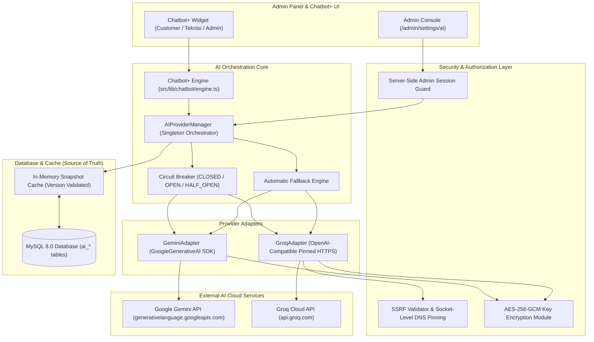
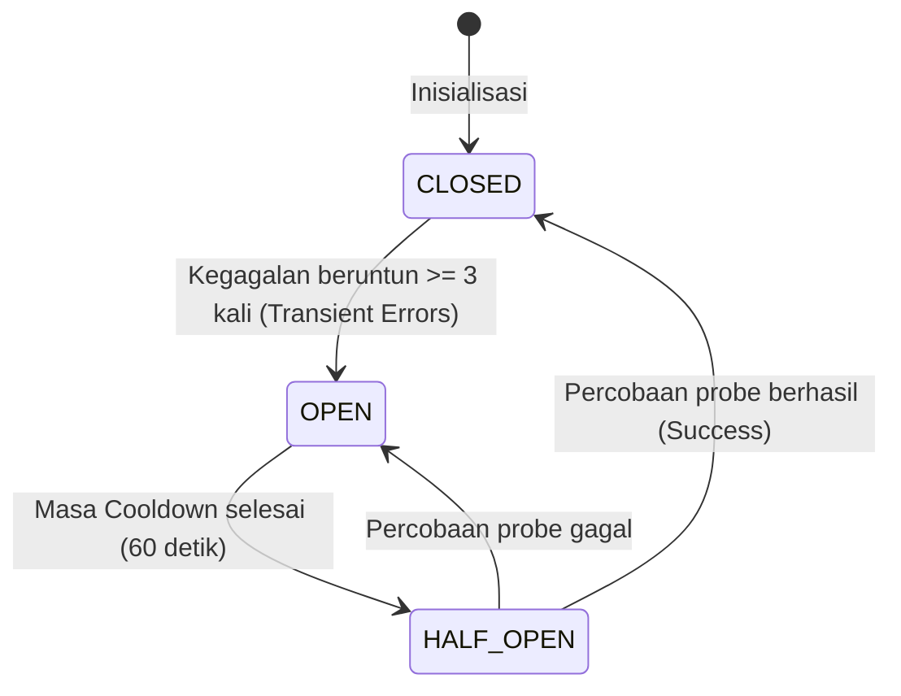

# Arsitektur AI Provider Management BANTUIN

Dokumen ini menjelaskan arsitektur teknis sistem **AI Provider Management** pada platform SaaS BANTUIN, yang memungkinkan administrator mengelola, menguji, dan mengalihkan layanan kecerdasan buatan antara **Google Gemini API** dan **Groq AI (LPU Inference)** tanpa downtime dan tanpa memodifikasi kode sumber.

---

## 1. Prinsip Desain Arsitektur

Arsitektur AI Provider Management dibangun dengan 6 prinsip utama:

1. **Vendor Agnostic & Universal Interface**: Menyediakan lapisan abstraksi tunggal (`UniversalToolDeclaration`, `UniversalChatMessage`, `AIChatRequest`, `AIChatResponse`) sehingga logika chatbot tidak terikat langsung pada format payload vendor tertentu.
2. **In-Flight Request Snapshot Isolation**: Setiap permintaan percakapan yang masuk mengambil snapshot konfigurasi aktif yang di-freeze. Perubahan provider yang dilakukan admin di tengah jalan tidak akan merusak permintaan yang sedang diproses.
3. **Multi-Instance Cache Invalidation**: Source of truth berada di database MySQL (`ai_global_settings`). Setiap pergantian konfigurasi menaikkan kolom `version` secara atomik, sehingga seluruh instance aplikasi menyegarkan cache lokal secara konsisten.
4. **Resilient Circuit Breaker & Automatic Fallback**: Melindungi sistem dari kegagalan beruntun dengan memantau tingkat kegagalan transient (HTTP 429, 5xx, timeout). Error permanen seperti 401 Unauthorized tidak memicu fallback untuk mencegah pemborosan kuota.
5. **Zero Trust & Zero Credential Leakage**: API Key dienkripsi menggunakan AES-256-GCM. Plaintext hanya ada di memori internal server saat eksekusi panggilan API dan tidak pernah dikembalikan ke client, response API, atau log audit.
6. **Socket-Level SSRF Protection**: Mencegah pemalsuan endpoint dan serangan DNS rebinding dengan validasi IP publik dan injeksi pinned IP langsung ke socket TLS.

---

## 2. Diagram Komponen Sistem



---

## 3. Universal Tool Calling & Function Calling Normalization

BANTUIN Assistant mendukung function calling untuk membaca data aktual database (pencarian pengguna, pesanan perbaikan, invoice, dan ketersediaan teknisi). Karena Google Gemini dan Groq AI (OpenAI format) memiliki spesifikasi tool yang berbeda, sistem menormalkannya ke antarmuka universal:

### A. Format Deklarasi Universal
```typescript
export interface UniversalToolDeclaration {
  name: string;
  description: string;
  parameters: {
    type: 'object';
    properties: Record<string, UniversalToolParameterProperty>;
    required?: string[];
  };
}
```

### B. Pemetaan Adapter
- **Google Gemini**: Dikonversi ke `functionDeclarations` di dalam objek tool GoogleGenerativeAI. Hasil eksekusi dikembalikan dalam role `function` dengan `functionResponse`.
- **Groq AI**: Dikonversi ke array `tools` dengan tipe `function`. Hasil eksekusi dikembalikan dalam format role `tool` berpasangan dengan `tool_call_id`.

---

## 4. State Machine Circuit Breaker



- **CLOSED**: Seluruh panggilan diteruskan ke provider utama secara normal.
- **OPEN**: Provider utama dinonaktifkan sementara. Jika Automatic Fallback aktif, panggilan langsung dialihkan ke provider cadangan tanpa menunggu timeout.
- **HALF_OPEN**: Satu request percobaan diizinkan melalui provider utama. Jika berhasil, sirkuit kembali ke `CLOSED`; jika gagal, sirkuit kembali `OPEN` dengan cooldown baru.

---

## 5. In-Flight Request Snapshot Isolation

Saat request obrolan masuk ke `AIProviderManager`:
1. `getActiveProviderSnapshot()` membaca konfigurasi provider aktif dan global settings.
2. Konfigurasi di-copy secara shallow (snapshot) dan diikat ke lifecycle request tersebut.
3. Jika pada saat yang bersamaan seorang administrator mengubah provider aktif dari Gemini ke Groq melalui Admin Panel, request yang sedang berjalan tetap menggunakan snapshot Gemini sampai selesai.
4. Request baru berikutnya akan otomatis mengambil provider Groq yang baru.

---

## 6. Integrasi Chatbot+ Pipeline

Pembaruan modul AI Provider Management tidak merusak pipeline kecerdasan basis data yang sudah berjalan sebelumnya:
- **Guard Layer (`guard.ts`)**: Tetap memvalidasi keselamatan darurat dan memblokir prompt injection.
- **Context Manager (`context-manager.ts`)**: Tetap mengekstrak entitas aktif (telepon, kode pesanan, email).
- **Schema Registry (`schema-registry.ts`)**: Tetap menyediakan metadata skema tabel secara dinamis.
- **Data Service & Allowlist Tools (`data-service.ts`, `tools.ts`)**: Tetap mengeksekusi parameterized query dengan otorisasi berbasis peran (RBAC).
- **Expert System Fallback**: Jika kedua provider AI offline atau tidak memiliki kredensial aktif, sistem secara anggun turun ke Intelligent Expert System BANTUIN.

