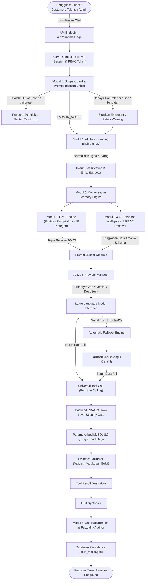

# ARSITEKTUR SISTEM BANTUIN AI INTELLIGENCE (2026 UPGRADE)

## 1. Ringkasan Eksekutif & Filosofi Desain

BANTUIN AI Assistant dirancang sebagai asisten kecerdasan buatan kelas enterprise yang melayani operasional platform perbaikan peralatan elektronik rumah tangga resmi di Indonesia. Sistem ini mengintegrasikan Large Language Model (Google Gemini, Groq, DeepSeek, OpenRouter) dengan basis data MySQL 8.0, mesin pemahaman bahasa alami (NLU), Pustaka Pengetahuan Resmi (RAG Engine), dan pengawal keamanan aplikasi (Scope Guard).

Sistem ini menganut prinsip **"Safety First, Factuality First, Zero-Trust Authorization"**:
- **Safety First:** Mendahulukan mitigasi keselamatan darurat pengguna atas insiden sengatan listrik, kebocoran gas, dan percikan api.
- **Factuality First:** Jawaban mengenai data operasional (pesanan, invoice, profil, teknisi) **wajib** didukung oleh eksekusi alat kueri backend aktual (Ground Truth). Dilarang keras berhalusinasi atau mengarang data transaksi saat hasil kueri kosong (`DATA_UNAVAILABLE`).
- **Zero-Trust Authorization:** Penegakan izin akses (RBAC & Row-Level Security) selalu dilakukan oleh server backend terotentikasi, bukan dipercayakan pada instruksi prompt LLM.

---

## 2. Diagram Alur Arsitektur End-to-End

---

## 3. Komponen Utama Arsitektur

### A. AI Understanding Engine (`src/lib/chatbot/understanding/`)
- Normalisasi singkatan dan bahasa gaul Indonesia (`sy`, `gmn`, `pesen`, `kulkas g adem`).
- Klasifikasi 12 kelas intent: `DIAGNOSIS_QUERY`, `ORDER_STATUS_QUERY`, `INVOICE_BILLING_QUERY`, `TECHNICIAN_QUERY`, `USER_PROFILE_QUERY`, `SYSTEM_APP_GUIDE`, `ADMIN_OPERATIONAL_QUERY`, `AI_SYSTEM_QUERY`, `SAFETY_HAZARD`, dll.
- Ekstraksi entitas terstruktur: `orderCode` (`#BAN-...`), `invoiceNumber` (`#INV-...`), `phoneNumber`, `email`, dan `applianceCategorySlug`.

### B. Knowledge Engine & RAG (`src/lib/knowledge/`)
- Penyimpanan dokumen pada tabel MySQL `ai_knowledge_base` dengan caching TTL in-memory.
- Pemeringkatan BM25 dengan multi-field boosting (Tag x6.0, Title x4.5, Summary x2.5, Content x1.0).
- Penyaringan peran dokumen (`allowedRoles`).
- Pembentukan konteks terformat lengkap dengan sitasi sumber resmi.

### C. Database Intelligence Engine (`src/lib/chatbot/db-intelligence/`)
- Introspeksi otomatis `information_schema.TABLES`, `COLUMNS`, dan `KEY_COLUMN_USAGE`.
- Deteksi otomatis kolom sensitif (password hash, token, encrypted secret, salt) dengan penandaan `isSensitive: true`.
- Eksekusi alat kueri backend terparameterisasi (read-only) untuk pengguna terotentikasi.
- Evidence Validator yang mencegah fabrikasi data saat kueri mengembalikan baris kosong.

### D. Role-Based AI Intelligence (`src/lib/chatbot/tools.ts`)
- Isolasi row-level security: Pelanggan hanya dapat mengakses order dan invoice miliknya sendiri (`userContext.userId`).
- Teknisi hanya dapat melihat pesanan aktif yang ditugaskan kepadanya.
- Tamu (`guest`) hanya dapat mengakses katalog layanan publik dan panduan aplikasi.
- Administrator memiliki hak akses monitoring operasional, keuangan, dan analitik kinerja.

### E. Anti-Hallucination & Scope Guard (`src/lib/chatbot/security/`)
- Evaluasi 7 status cakupan (`IN_SCOPE`, `OUT_OF_SCOPE`, `AMBIGUOUS`, `DATA_UNAVAILABLE`, `DATA_ACCESS_ERROR`, `UNAUTHORIZED`, `INSUFFICIENT_EVIDENCE`).
- Pertahanan terhadap injeksi prompt dan ekstraksi system prompt.
- Penegakan kebenaran (Factuality Auditor) yang mendeteksi dan menolak klaim palsu jika kueri basis data kosong.

### F. Multi-Turn Conversation Memory (`src/lib/chatbot/memory/`)
- Mempertahankan entitas aktif (`activeOrderCode`, `activeInvoiceNumber`, `activePhoneNumber`, dll.) per sesi percakapan.
- Memungkinkan penanganan pertanyaan lanjutan (*follow-up questions*) tanpa meminta pengguna mengulang nomor pesanan.

### G. AI Administration & Diagnostics (`src/components/admin/`)
- Panel terintegrasi di Admin Console:
  1. Knowledge Base RAG Management (CRUD, status toggle, search).
  2. Database Intelligence Schema Explorer (live metadata & sensitivity tags).
  3. AI Testing Playground & Diagnostic Telemetry.
  4. Benchmark Evaluation Suite & Quality Reporting.

